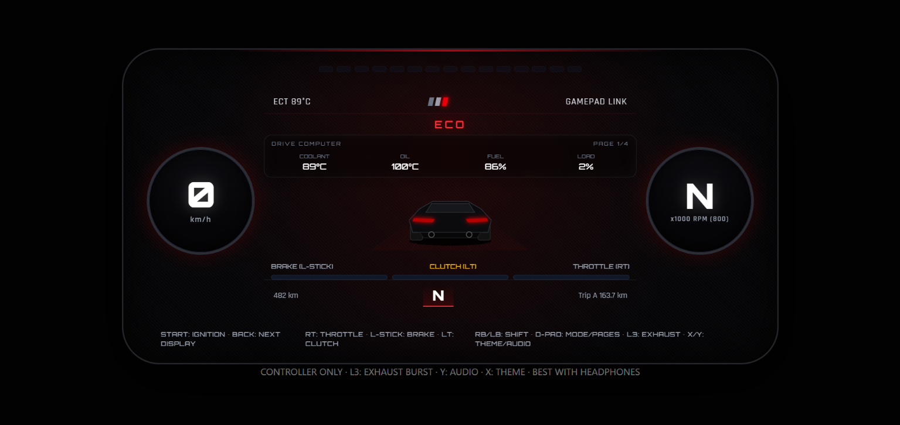
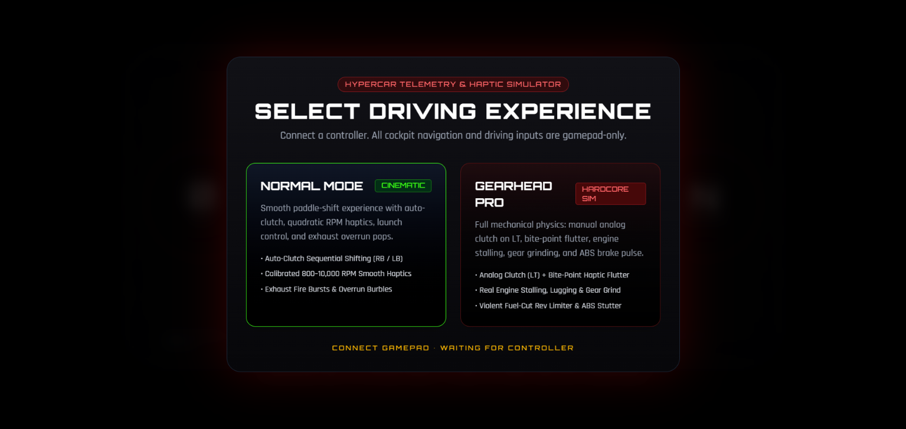
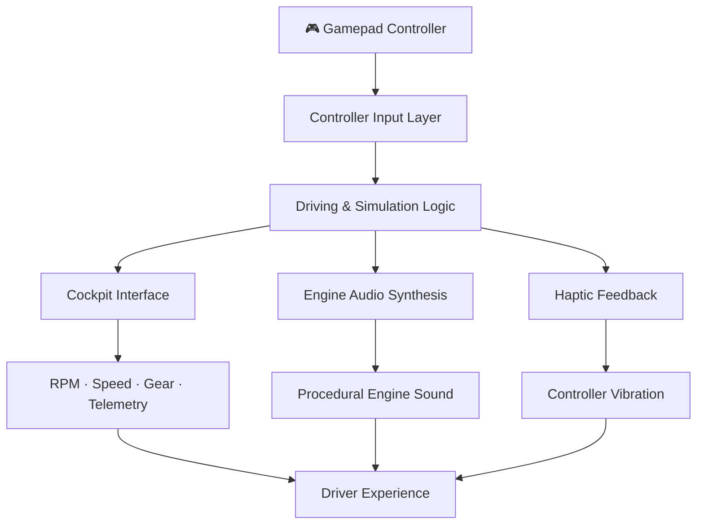

# 🏎️ GearShifters Simulator

<p align="center">
  
  
  
</p>

<h3 align="center">
  A hypercar cockpit. Your controller. Your driving experience.
</h3>

<p align="center">
  An interactive V10 hypercar telemetry and haptic simulator built for the browser, featuring procedural engine audio, dynamic cockpit instrumentation, controller vibration, and two distinct driving experiences.
</p>

<p align="center">
  
</p>

<p align="center">
  
</p>

---

## 01. Project Showcase

**Experience the cockpit, not just the interface.**

GearShifters Simulator brings a hypercar-inspired driving experience directly into your browser. Instead of traditional keyboard-based interaction, the entire experience is designed around gamepad controls.

From engine revs and sequential shifting to mechanical feedback and cockpit telemetry, every interaction is designed to make the simulator feel alive.

**Experience it here:**

🌐 **Live Application:** https://gear-shifters-simulator.vercel.app/

🎮 **Input:** Compatible Bluetooth and USB gamepads.

🔊 **Audio:** Procedurally synthesized engine sound.

📳 **Feedback:** Controller-based haptic effects where supported.

---

## 02. About the Project

GearShifters Simulator is a browser-based automotive simulation experiment focused on recreating the interaction and feedback of a high-performance hypercar cockpit.

The project explores how web technologies can deliver an immersive driving interface by combining real-time visual feedback, controller input, synthesized audio, and haptic responses.

Rather than building another conventional racing game, the idea was to create an interactive cockpit experience where the controller becomes the primary interface between the driver and the machine.

**Two driving experiences. Two different personalities.**

- **Normal Mode:** A cinematic, smooth paddle-shifting experience designed around accessible driving interactions.
- **Gearhead Pro:** A more demanding mechanical simulation that introduces manual clutch control and additional driving feedback.

---

## 03. Features & Driving Experiences

### 🏁 Normal Mode — Cinematic

A smooth, performance-focused driving experience.

- **Auto-Clutch Sequential Shifting:** Paddle-based gear changes using RB/LB.
- **Dynamic RPM Haptics:** Smooth controller vibration calibrated across an 800–10,000 RPM range.
- **Launch Control:** A dedicated launch-oriented driving interaction.
- **Exhaust Overrun:** Simulated exhaust pops and burble effects.
- **Smooth Driving Feedback:** Designed for an accessible, cinematic experience.

### ⚙️ Gearhead Pro — Hardcore Simulation

A more demanding experience focused on mechanical interaction.

- **Analog Clutch:** Manual clutch control using LT.
- **Bite-Point Feedback:** Haptic flutter when interacting with the clutch engagement point.
- **Engine Stalling:** Engine response to improper clutch and throttle interaction.
- **Gear Grinding:** Mechanical feedback when shifting incorrectly.
- **Engine Lugging:** Simulated low-RPM engine strain.
- **Fuel-Cut Rev Limiter:** Aggressive limiter feedback.
- **ABS Feedback:** Simulated brake-pulse vibration.

### 🖥️ Digital Hypercar Cockpit

A driver-focused instrument cluster featuring:

- Digital tachometer and RPM visualization.
- Speedometer with real-time speed display.
- Engine coolant temperature.
- Current gear indication.
- Distance and trip information.
- Cockpit status and controller connection indicators.
- Additional display and theme interactions.

---

## 04. Controller Configuration

**No keyboard driving. No mouse-based cockpit navigation. Just the controller.**

The simulator is designed around gamepads connected through Bluetooth or USB.

### Main Controls

| Controller Input | Function |
|:---|:---|
| RT | Throttle / Acceleration |
| Left Stick | Brake |
| LT | Clutch (Gearhead Pro) |
| RB | Shift Up |
| LB | Shift Down |
| D-Pad | Mode / Display Navigation |
| L3 | Exhaust Burst |
| X | Cockpit Theme |
| Y | Audio Toggle |
| START | Ignition |
| BACK | Next Display |

### Controller Compatibility

Compatible with generic Bluetooth and USB gamepads that expose their inputs through the browser's Gamepad API.

**Note:** Haptic feedback availability depends on controller hardware and browser support. Not every gamepad exposes vibration capabilities.

For the best experience, use a modern Chromium-based browser and a compatible gamepad.

---

## 05. Technology Stack

Built using modern web technologies, combining interactive interfaces with browser-native capabilities.

### Frontend & Interface

<p>
  
</p>

| Technology | Role |
|:---|:---|
| Next.js 16 | Application framework |
| React 19 | Component-based interface |
| JavaScript | Application logic and interactions |
| Tailwind CSS 4 | Styling and interface design |

### Browser Capabilities

| Technology / API | Role |
|:---|:---|
| Gamepad API | Controller input handling |
| Gamepad Haptics | Controller vibration and feedback |
| Audio Synthesis | Procedurally generated engine audio |
| Browser Rendering | Dynamic cockpit and telemetry visualization |

### Deployment & Development

<p>
  
</p>

| Technology | Role |
|:---|:---|
| Node.js | Development runtime |
| npm | Package management |
| Vercel | Cloud deployment and hosting |

---

## 06. Getting Started

Want to run the simulator locally or explore its implementation?

Follow these steps.

### Prerequisites

- Node.js installed.
- npm package manager.
- A modern web browser.
- A compatible Bluetooth or USB gamepad for the intended experience.

### Installation

**1. Clone the repository**

```bash
git clone https://github.com/Lavish870/GearShifters-Simulator.git
```

**2. Navigate into the project**

```bash
cd GearShifters-Simulator
```

**3. Install dependencies**

```bash
npm install
```

**4. Start the development server**

```bash
npm run dev
```

**5. Open the application**

Visit:

```text
http://localhost:3000
```

### Production Build

To create a production build:

```bash
npm run build
```

To run the production server:

```bash
npm run start
```

---

## 07. Architecture & Working Concept

The simulator brings together several browser capabilities to create a unified cockpit experience.

### High-Level Architecture



### Core Systems

**1. Controller Input**

The browser's Gamepad API provides controller input for throttle, braking, clutch, shifting, and cockpit navigation.

**2. Driving Simulation**

The simulation logic interprets driver inputs and updates the relevant driving and cockpit state.

**3. Cockpit Rendering**

The interface presents the current driving state through digital gauges, telemetry, and visual indicators.

**4. Procedural Audio**

Engine audio is synthesized through code rather than relying entirely on prerecorded engine recordings. This allows the sound experience to be integrated with the simulation.

**5. Haptic Feedback**

Controller vibration provides additional feedback for RPM behaviour, clutch engagement, shifting, and other driving events, depending on hardware support.

### Deployment

The application is deployed on Vercel.

🔗 https://gear-shifters-simulator.vercel.app/

---

<p align="center">
  <b>Built with curiosity, code, and a little obsession with machines.</b>
</p>

<p align="center">
  <i>GearShifters Simulator — Where the browser meets the driver's seat.</i>
</p>